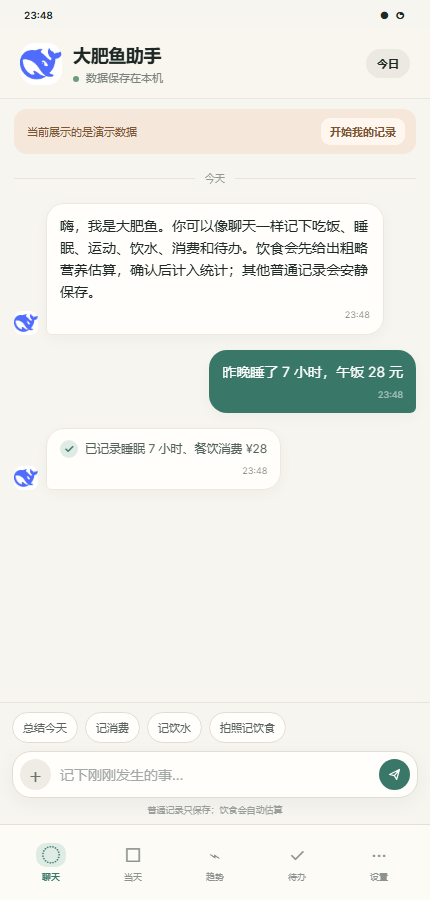

# 大肥鱼助手

大肥鱼助手是一款面向个人自用的、本地优先的生活记录与 AI 分析应用。它采用聊天式输入，可记录饮食、饮水、睡眠、运动、消费、普通生活事件和待办，并通过“当天”和“趋势”页面查看积累的数据；需要分析时，再调用 DeepSeek 生成餐食营养估算、日总结、周总结、月总结或生活建议。

当前版本：**v0.8.4**

Android 包名：`com.dafeiyu.assistant`

> 项目只供个人使用，不含账号、云同步、公开后端或主动通知功能。数据默认保存在当前设备上。

## Demo 与安装包



- 网页 Demo：首次在新的浏览器数据空间打开 `dist` 时，会自动载入一组虚构数据，不需要 API Key。
- 演示步骤：见 [docs/DEMO.md](./docs/DEMO.md)。
- Android 安装包：[大肥鱼助手-v0.8.4.apk](./大肥鱼助手-v0.8.4.apk)。
- APK SHA-256：`D3DC356F1BB978748B35AFA8765B62AEE99D63451797266CD4E8F9C837442A55`

仓库和安装包均不包含 API Key、个人记录或签名私钥。安装 APK 后，请在“设置”中仅在自己的设备上填写 Key。

## 主要功能

- 聊天式记录：用自然语言输入刚刚发生的事情，不要求固定格式。
- 自动分类：识别饮食、饮水、睡眠、运动、消费、待办，以及工作、学习、家务、社交、娱乐、出行、用眼和身体感受等普通生活事件。
- 混合理解：简单记录在本地快速解析；团购券、退款、核销、口头纠错和自由生活事件由 AI 转成结构化操作，再由应用校验后写入。
- 意图防误记：先区分已发生事实、计划、否定、提问和假设，只有明确发生的事件才会直接写入数据库。
- 跨类别问句保护：饮水建议、运动假设、消费预算、睡眠咨询和待办查询不会因为出现数字或类别关键词而误落库。
- 组合记录：一句话可以同时记录多个项目，例如“昨晚睡了 7 小时，坐公交花了 2 元”。
- 操作结果卡：每次真正写入、修改或删除本地数据后，都会列出实际发生的变更；只有结果卡表示操作已经落库。
- 一键撤销：聊天记录、AI 结构化操作、餐食确认以及“当天”页面的人工新增、修改和删除均可撤销。
- 时间信息：保留用户明确说出的钟点；只说“上午、下午、晚上”等时段时，会保存为标注“约”的时段默认时间，而不是消息发送时间。
- 口语兼容：支持“喝了水 250 毫升”“骑了 12 公里自行车”“一万步”等常见倒装、中文数量和省略表达。
- 跨天睡眠：保存完整入睡与起床时间，时长跨午夜正确计算，并统一归入起床当天；支持“零点至今早八点二十”等口语时间。
- 餐食分析：支持文字描述和照片，估算热量、蛋白质、碳水和脂肪。
- 热量问答分流：单餐估算生成餐食卡；昨日总摄入、阶段热量与热量缺口读取历史记录回答，不会误建一顿餐食。
- 人工确认：餐食估算在确认后才计入当天与趋势统计，避免把 AI 猜测直接当作事实。
- 数据视图：“当天”页面按事件时间形成时间轴，同时展示待办；“趋势”页面汇总饮食、消费、饮水、睡眠和运动。
- 人工维护：在“当天”页面可以新增七类记录，也可以直接编辑每张记录卡的内容、日期和时间或二次确认后删除；修改会立即同步到当天与趋势。
- AI 对话：问候、追问和建议类消息会正常回复；普通记录默认安静保存。
- 餐食建议：询问“吃什么、怎么搭配、现有食材能做什么”会进入自然对话，不会误生成待确认餐食卡。
- 待确认餐食隔离：每日营养推荐量、饮食建议和其他新问题不会被误当成对上一张餐食卡的修改或补充。
- 总结复盘：按需生成日、周、月总结，每次最多给出 5 条建议。
- 个性化助手：可直接在聊天中调整关注重点、目标、回复长度、语气和自定义领域；应用会显示变更卡，确认后才生效。
- 本地备份：完整导出和导入 JSON，用于换设备、恢复数据或版本升级前备份。
- Android APK：无需自建服务器，安装后可直接离线记录；AI 功能需要联网。

## 应用如何决定是否调用 AI

应用并不会把每句话都发给 AI：

| 输入类型 | 默认行为 |
| --- | --- |
| “喝水 250 毫升”“公交花了 2 元” | 本地解析并保存，不打扰用户 |
| “晚饭吃了一碗牛肉粉” | 保存待确认餐食，并调用 AI 估算营养 |
| 上传午饭照片 | 调用 AI 识别餐食与营养，等待用户确认 |
| “买了餐食团购券，还没吃” | 记录餐饮支出和未使用券，不记录营养摄入 |
| “收到上一笔团购券退款” | 记录退款、关联原消费，并从净消费中扣除 |
| “刚才那笔消费改成 19.9 元” | AI 定位近期记录，代码校验后修改原记录 |
| “下午整理房间 40 分钟”“连续看电脑三小时，眼睛有点干” | 保存为带时间、分类和时长的生活事件 |
| “以后重点关注睡眠”“我想关注用眼情况” | 生成个性化设置变更卡，确认后影响后续分析 |
| “你好”“建议我晚上吃什么” | 调用 AI 进行自然对话或给出建议 |
| “总结今天 / 本周 / 本月” | 读取对应时间范围内的相关记录后生成总结 |

AI 请求只携带完成当前问题所需的近期记录、相关统计和少量聊天上下文，不会在每次对话中发送整份历史备份。

## 技术结构

- 前端：原生 HTML、CSS、JavaScript，无打包步骤。
- 本地存储：浏览器 / WebView 的 IndexedDB。
- AI：DeepSeek OpenAI 兼容接口，当前模型配置见 `dist/assistant-core.js`。
- Android：原生 WebView 外壳，将 `dist` 目录作为应用资源打包。
- 网络：只有 AI 功能需要访问 DeepSeek API；本地记录、查看和导出不依赖服务器。

```text
feiyu-assistant/
├─ dist/                       网页应用源码，也是 APK 内置资源
│  ├─ index.html
│  ├─ app.css
│  ├─ app.js                   页面、状态和 IndexedDB 逻辑
│  ├─ record-parser.js         自然语言记录解析
│  ├─ record-operations.js     记录聚合、修改与删除
│  ├─ profile-core.js          个性化设置、校验与变更
│  └─ assistant-core.js        DeepSeek 请求与 AI 提示词
├─ android/                    Android WebView 工程（真实签名文件不入库）
├─ docs/                       无真实数据的 Demo 截图与演示说明
├─ tests/                      本地自动测试和可选的真实 AI 测试
├─ build-apk.ps1              一键测试并构建 release APK
├─ APK-BUILD.md               APK 构建与更新说明
├─ CHANGELOG.md                版本更新记录
└─ 大肥鱼助手-v0.8.4.apk       当前签名安装包
```

## 在电脑上预览

直接通过 HTTP 静态服务器打开 `dist`，不要双击 `index.html` 使用 `file://` 访问，否则部分浏览器能力可能受限。

如果电脑已安装 Python，可在项目根目录运行：

```powershell
python -m http.server 4191 --directory .\dist
```

然后访问：

```text
http://127.0.0.1:4191/
```

首次使用时进入“设置”，填写自己的 DeepSeek API Key。Key 会保存在当前浏览器或 APK 的本地 IndexedDB 中；电脑预览版和手机 APK 是两个独立的数据空间。

新浏览器会先显示虚构的 Demo 数据；开始写入自己的第一条记录时，应用会自动退出 Demo 模式并移除示例数据。

## 数据与备份

- 所有生活记录、聊天、待办和设置默认保存在当前设备的 IndexedDB 中。
- “导出完整 JSON”会导出可恢复的应用状态，但会主动清空导出文件中的 API Key。
- 导入完整 JSON 相当于恢复应用保存的长期记录；AI 仍会按当前问题选取相关数据，不会一次读取全部历史。
- 备份文件未加密，请像保管私人日记一样妥善保存。
- 浏览器数据可能被系统清理，卸载 APK 也会删除应用数据，因此应定期导出 JSON 到电脑。

## API Key 与安全边界

本项目为纯自用方案，前端会直接请求 DeepSeek API，不经过自建后端。这样部署最简单，但也意味着：

- API Key 存在设备本地，无法获得后端代理所提供的密钥保护。
- 不要把填有 Key 的调试数据、安装包改版或浏览器存储交给他人。
- 不要将 Key 写入 README、测试报告或提交到公开代码仓库。
- 若 Key 曾公开泄露，应立即在 DeepSeek 控制台撤销并重新生成。

图片会在前端处理后随餐食分析请求发送给 DeepSeek；应用不会自动把本地数据库整体上传。

## 运行测试

需要 Node.js。项目根目录下执行：

```powershell
powershell -ExecutionPolicy Bypass -File .\tests\run-tests.ps1
```

测试覆盖语法检查、数百种生活场景路由、个性化设置、AI 结构化操作契约、餐食响应契约、删除与聚合、备份隐私、离线资源和版本一致性等内容。

`tests/live-ai-scenarios.cjs` 是可选的真实 DeepSeek 接口测试，会产生少量 API 费用。它从标准输入读取 Key，不应把 Key 写进命令历史或测试文件。日常改动优先运行本地测试，只在 AI 提示词或接口逻辑发生变化时进行小规模真实调用。

## 构建 APK

当前电脑已经按 `build-apk.ps1` 的约定准备了 JDK、Gradle 和 Android SDK。运行：

```powershell
powershell -ExecutionPolicy Bypass -File .\build-apk.ps1
```

脚本会：

1. 运行全部本地网页测试。
2. 构建签名后的 release APK。
3. 从 `dist/app.js` 读取版本号。
4. 在项目根目录生成 `大肥鱼助手-v版本号.apk`。

详细说明见 [APK-BUILD.md](./APK-BUILD.md)。

## 版本更新流程

1. 修改 `dist` 中的网页代码并在电脑上预览。
2. 运行本地测试，必要时再做小规模真实 AI 测试。
3. 更新 `dist/app.js` 顶部的 `APP_VERSION`，并同步检查页面展示的版本号。
4. 运行 `build-apk.ps1` 生成新 APK。
5. 在手机上直接覆盖安装，**不要先卸载旧版本**。
6. 大版本更新前先从旧版本导出完整 JSON 备份。

Android 的 `versionCode` 会根据 `APP_VERSION` 自动生成。后续版本必须继续使用相同的包名和签名证书，才能覆盖安装并保留原应用数据。以下文件尤其重要，应在本机单独离线备份，不进入 GitHub：

```text
android/signing/dafeiyu-release.jks
android/signing/keystore.properties
```

签名配置包含敏感信息，不应上传到公开仓库。

## 当前限制

- 自然语言解析覆盖常见生活表达，但无法保证理解所有省略、反讽或非常复杂的句子。
- 餐食图片无法精确得知重量、配料和用油量，营养结果始终是单一的近似值，不是检测结果。
- 未提供时长的运动可以被记录，但无法可靠计入运动分钟数。
- 应用没有多设备实时同步；电脑与手机之间依靠完整 JSON 手动迁移。
- AI 建议只用于日常生活参考，不能替代医生、营养师或财务专业人士的判断。

## 项目定位

该项目目前不做多用户、账号系统、公开部署、云同步、主动通知或应用商店上架。优先目标是：在一台安卓手机上长期、低打扰地记录真实生活，并让数据在日、周、月尺度上逐渐形成有用的个人反馈。

本项目暂未设置开源许可证，仅作个人自用。
